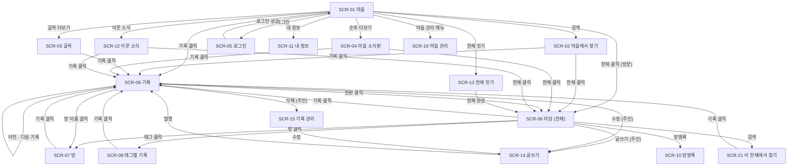

# 한채 기능명세서

## 문서 정보

| 항목 | 내용 |
| --- | --- |
| 문서명 | 한채 기능명세서 (민주 개인 설계 문서) |
| 버전 | 0.15 |
| 작성자 | Minju |
| 최초 작성일 | 2026-10-02 |
| 최종 수정일 | 2026-10-12 |
| 기준 문서 | 1팀 블로그 통합 기능명세서 v0.2 (`docs/1팀_블로그_통합_기능명세서.md`) |

### 변경 이력

| 버전 | 날짜 | 작성자 | 변경 내용 |
| --- | --- | --- | --- |
| 0.1 | 2026-10-02 | Minju | 개요 최초 작성 (블로그 플랫폼 기준) |
| 0.2 | 2026-10-03 | Minju | 문서 정보 · 변경 이력 추가, 회원가입을 소셜 로그인 방식으로 변경 |
| 0.3 | 2026-10-03 | Minju | 서비스 목적에 글 노출 방향 반영, 홈 화면 · 검색 기능 방향 정의, 화면 목록 · 화면 흐름도 추가 |
| 0.4 | 2026-10-03 | Minju | 홈 화면 랭킹 기준 확정 (조회수, 최근 1시간, 정각 갱신), 주제는 티스토리 방식으로 결정 |
| 0.5 | 2026-10-03 | Minju | 용어 정의 추가 |
| 0.6 | 2026-10-03 | Minju | 기능 목록 추가 |
| 0.7 | 2026-10-08 | Minju | 통합 기능명세서 v0.2 기준으로 재작성. 서비스 콘셉트를 "한 사람이 한 채의 집을 짓고 기록을 쌓는 마을"로 확장. 서비스 용어집 · 선택 항목 · 디자인 방향 추가, 화면 목록 · 메인 화면 · 기능 목록을 한채 세계관으로 개편. 기능 ID를 통합 ID(`AUTH-01` 등)로 교체 |
| 0.8 | 2026-10-08 | Minju | 기준 ERD를 Crowfoot 「한채 블로그 플랫폼」으로 정함. 글 주소를 한채마다 1부터 매기는 번호로 변경(선택 7.5), ERD에 이웃 공개(`SUBSCRIBERS`) 반영 |
| 0.9 | 2026-10-08 | Minju | 미결정 사항 정리(9.2): 소셜 제공사, 골목 목록, 조회수 중복, 순위 대체 기준, 다시 짓기, 탈퇴 처리, 대문 연출, 로그인 유지 기간 확정. 자율 값(8장) 채움 |
| 0.10 | 2026-10-08 | Minju | 디자인 시스템 「한채」 작성에 맞춰 4.3 색과 글꼴을 토큰 기준으로 정리. 강조 색을 인주 빨강 · 단청 청록 두 가지로 역할을 나눔(기존 목업 색 유지) |
| 0.11 | 2026-10-08 | Minju | 백엔드 프레임워크를 Django로 확정 (1.5) |
| 0.12 | 2026-10-10 | Minju | 나눔붓글씨를 쓰지 않기로 함(가독성). 현판 · 기록 제목 · 큰 화면 제목은 Hahmlet으로 (4.2, 4.3) |
| 0.13 | 2026-10-10 | Minju | 제목 글꼴을 Hahmlet에서 Gugi로 변경. 마을 어귀 문구 · 현판 · 기록 제목 모두 Gugi (4.3) |
| 0.14 | 2026-10-10 | Minju | 색을 초가집 느낌(누런 한지 · 밝은 갈색)에서 기와집 색(회벽 · 청회색 기와 · 적갈색 기둥 · 단청)으로 변경 (4.3) |
| 0.15 | 2026-10-12 | Minju | 마을(SCR-01)을 두 칸으로: 왼쪽은 기록(어귀 · 골목 · 이웃 소식 · 새 기록), 오른쪽은 스크롤을 따라오는 고정 사이드바(로그인 · 인기 기록 · 북적이는 한채) (5.3) |

### 이 문서와 통합 기능명세서의 관계

- **통합 기능명세서**가 "무엇을 만드는가"(기능, 우선순위, 동작 규칙)를 정한다. 이 문서는 그 규칙을 다시 적지 않는다.
- **이 문서**는 한채가 "어떻게 보이고 어떻게 느껴지는가"(콘셉트, 용어, 화면, 디자인)와 통합 명세 7장의 선택 항목에서 고른 방식을 정한다.
- 기능은 통합 ID(`POST-01` 등)로 가리킨다. 동작 규칙이 궁금하면 통합 명세 6장의 같은 ID를 본다.

---

## 1. 개요

### 1.1 서비스 소개

| 항목 | 내용 |
| --- | --- |
| 서비스명 | 한채 |
| 한 줄 소개 | 누구나 자기 집 한 채를 짓고, 그 안에 기록을 쌓고, 이웃의 집을 찾아가는 동양풍 블로그 플랫폼 |
| 핵심 콘셉트 | **한 사람이 하나의 집(한채)을 갖고, 그 안에 자신의 기록을 쌓아 간다** |
| 참고 서비스 | 티스토리 (기능 구성), 한옥 (공간 구성) |
| 운영자 | Minju |
| 서비스 형태 | 웹 기반 블로그 플랫폼 (프론트엔드 + 백엔드 서버 + 데이터베이스) |

한채는 블로그의 구조를 **집이라는 공간**으로 다시 풀어낸 블로그 서비스다.

회원은 자기 블로그를 여는 대신 **한채를 짓고**, 그 집의 **주인**이 된다. 한채 안에는 주제별로 **방**이 있고, 글은 방마다 **기록**으로 쌓인다. 다른 사람의 블로그를 보는 일은 **다른 한채에 방문**하는 일이고, 마음에 드는 한채와는 **이웃**을 맺는다. 방문객은 주인에게 **방명록**으로 인사를 남긴다. 그리고 이 모든 한채가 모여 하나의 **마을**을 이룬다. 서비스의 메인 화면이 바로 그 마을이다.

```
                    [ 한채 마을 ]  ← 서비스 메인

     ┌──── 민주의 한채 ────┐        ┌──── 서현의 한채 ────┐
     │  마당 (최근 기록)    │  방문   │  마당 (최근 기록)    │
     │  ├ 개발방           │ ─────▶ │  ├ 기록방           │
     │  ├ 여행방           │  이웃   │  ├ 취미방           │
     │  └ 일상방           │ ◀───── │  └ 생각방           │
     │  방명록             │        │  방명록             │
     └────────────────────┘        └────────────────────┘
```

**한옥 디자인을 입힌 블로그가 아니다.** 티스토리형 블로그의 기능(소셜 로그인, 블로그 개설 · 설정, 글 작성 · 수정 · 삭제, 카테고리 · 태그, 이미지 업로드, 공개 · 비공개, 댓글 · 공감, 구독, 방명록, 검색, 인기 글 · 인기 블로거, 관리자 기능)은 통합 명세 그대로 가져가고, 그 기능을 사용자에게 보여 주는 **언어, 화면 구성, 이동 경험**을 한채의 공간 개념에 맞춘다.

### 1.2 서비스 목적

> 자신만의 한채에 기록을 쌓고, 다른 사람의 한채를 방문하며 다양한 이야기를 발견하고 교류하는 서비스

| 목적 | 설명 | 관련 기능 |
| --- | --- | --- |
| **나만의 집에 기록을 쌓는다** | 한 사람이 한 채를 갖는다. 방(카테고리)과 태그로 기록을 정리하며, 시간이 지날수록 집이 채워지는 감각을 준다 | BLOG, POST, CAT, TAG |
| **다른 한채를 찾아가 발견한다** | 마을(메인)에서 지금 많이 읽히는 기록, 인기 있는 한채, 골목(주제)별 기록, 새 기록을 최대한 많이 보여 준다. "블로그를 검색한다"가 아니라 "다른 사람의 한채를 찾아간다"는 경험으로 만든다 | HOME, SRCH |
| **이웃과 교류한다** | 마음에 드는 한채와 이웃을 맺고 새 기록을 받아 본다. 기록에는 댓글과 공감을, 한채에는 방명록으로 인사를 남긴다 | SUB, CMT, SOC |
| **공간이 있는 경험** | 화면 이동이 `마을 → 대문 → 마당 → 방 → 기록`의 공간 흐름으로 느껴지게 한다. 동양풍 요소는 장식이 아니라 이 흐름을 보여 주는 데 쓴다 | 4장 디자인 방향 |

### 1.3 문서 목적

이 문서는 한채의 각 기능이 **어떤 화면에서, 어떤 이름으로, 어떻게 보이는지**를 정의한다.

- 화면과 UI 문구를 만들 때 기준으로 쓴다.
- 통합 명세의 선택 항목 중 한채가 고른 방식을 밝힌다.
- 통합 명세와 다르게 하는 부분과 그 이유를 남긴다.

### 1.4 대상 사용자

| 사용자 (내부 용어) | 한채에서 부르는 이름 | 설명 |
| --- | --- | --- |
| 비회원 | 나그네 | 로그인하지 않고 마을과 한채를 둘러보는 사용자 |
| 회원 | 마을 사람 | 로그인한 사용자. 댓글, 공감, 이웃 맺기, 방명록을 쓸 수 있다 |
| 블로그 주인 | 주인 | 한채를 지은 회원. 자기 한채의 방, 기록, 방명록, 설정을 관리한다 |
| 서비스 관리자 | 마을 관리인 | 한채 운영자. 회원과 게시물을 관리하고 신고를 처리한다 |

> "나그네", "마을 사람", "마을 관리인"은 안내 문구에서만 쓰는 표현이다. 버튼과 오류 메시지에는 쓰지 않는다 (2.1 원칙 3).

### 1.5 기술 환경 요약

| 구분 | 내용 |
| --- | --- |
| 프론트엔드 | HTML, CSS, JavaScript |
| 백엔드 | Python · **Django** (API는 Django REST Framework, 이메일 · 소셜 로그인은 django-allauth). 기준 ERD가 Django 구조(`users`, `account_emailaddress`, `socialaccount_socialaccount`)라 그대로 쓴다 |
| 데이터베이스 | MySQL |
| 인증 | 이메일 + 소셜 로그인 (OAuth 2.0). 소셜 제공사는 카카오 · 구글 · 네이버 |
| 에디터 | WYSIWYG (본문은 HTML로 저장, 새니타이즈 필수) |
| 화면과 서버 | 프론트엔드(JS)가 화면을 그리고 서버는 REST API(JSON)만 준다. API 목록은 `docs/API명세서.md` |

### 1.6 범위

**포함 범위**: 통합 명세 1.2의 13개 영역. 한채에서 어느 단계에 만들지는 6장 기능 목록에 적는다.

**제외 범위**: 통합 명세 1.2의 제외 범위에 더해, 한채가 블로그가 아니라 게임 · 메타버스처럼 보이게 만드는 기능은 넣지 않는다.

| 넣지 않는 기능 | 이유 |
| --- | --- |
| 가구 배치, 집 꾸미기, 방 꾸미기 시스템 | 기록보다 꾸미기가 목적이 된다. 통합 명세 BLOG-05(스킨 · 배경)도 한채에서는 넣지 않는다 |
| 아이템 수집, 재화 | 블로그가 아니라 소셜 게임이 된다 |
| 한채 레벨, 등급 | 기록의 가치를 점수로 매기게 된다 |
| 아바타, 캐릭터 이동 | 짧은 개발 기간에 맞지 않고, 글 읽기를 방해한다 |
| 마을 지도에서 집을 클릭해 들어가는 화면 | 글보다 연출이 앞선다. 마을은 지도가 아니라 **목록과 랭킹**으로 보여 준다 |

**원칙**: 새 기능을 더하지 않고, **블로그를 쓰는 행위 자체가 한채를 쓰는 경험처럼 느껴지게** 만드는 데 집중한다.

### 1.7 참고 문서

| 문서 | 설명 |
| --- | --- |
| 1팀 블로그 통합 기능명세서 v0.2 | 기능, 우선순위, 동작 규칙의 기준 |
| 한채 API 명세서 (`docs/API명세서.md`) | 1차 기능의 화면별 REST API |
| 포트폴리오 블로그 서비스 요구사항 명세서 (2026-10-01) | 1인 정적 블로그 버전의 요구사항 정리본. 현재 목업(`index.html`, `blog.html`, `post.html`, `admin/write.html`)의 근거 |
| 티스토리 | 기능 구성과 화면 흐름 참고 |

---

## 2. 용어집

### 2.1 원칙

1. **내부는 그대로, 화면만 한채로.** DB 테이블, 코드, API, 통합 명세의 용어(Blog, Post, Category 등)는 바꾸지 않는다. 사용자에게 보이는 화면과 문구에만 한채 용어를 쓴다. 팀 ERD와 통합 명세를 그대로 쓸 수 있고, 내부 용어가 둘로 갈려 헷갈리는 일을 막는다.
2. **공간 이름은 한채 용어, 행동 이름은 익숙한 말.** 화면 제목, 메뉴, 영역 이름(마을, 한채, 방, 마당)은 한채 용어를 쓴다. 버튼처럼 누르면 무언가 일어나는 곳(저장, 삭제, 로그인, 검색)은 누구나 바로 알아듣는 말을 쓰고, 필요하면 한채 용어를 함께 쓴다. 예: "한채 짓기" 버튼은 쓰되, 저장 버튼을 "봉하기"로 바꾸지 않는다.
3. **오류 · 경고 문구는 분명하게.** 삭제 확인, 권한 없음, 입력 오류처럼 실수하면 안 되는 문구는 세계관보다 정확성을 앞세운다.
4. **용어는 이 표에 있는 것만 쓴다.** 새 용어가 필요하면 이 표에 먼저 더한다.

### 2.2 핵심 용어 (확정)

| 내부 용어 (코드 · DB · 통합 명세) | 한채 용어 (화면) | 뜻 |
| --- | --- | --- |
| Platform / 홈 | **마을** | 여러 한채가 모여 있는 서비스 전체, 그리고 서비스 메인 화면 |
| Blog | **한채** | 회원 한 사람이 지은 집. 블로그 하나 |
| Blog Owner / 블로그 주인 | **주인** | 한채를 지은 회원 |
| Blog Creation / 블로그 개설 | **한채 짓기** | 회원이 자기 한채를 처음 만드는 것 |
| Blog Home / 블로그 메인 | **한채** (첫 화면은 **마당**) | 한채에 들어가면 처음 보이는 화면 |
| Category / 카테고리 | **방** | 한채를 구성하는 주제별 공간. 예: 개발방, 여행방 |
| Post / 글 | **글 · 기록** | 한채 안에 쌓이는 글. 목록 · 영역 이름은 "기록", 단건은 "글"로 불러도 된다 |
| Blog Visit | **한채 방문** | 다른 사람의 한채 화면에 들어가는 것 |
| Subscribe / 구독 | **이웃** | 다른 한채의 새 기록을 받아 보려고 맺는 관계. "이웃 맺기 · 이웃 끊기" |
| Guestbook / 방명록 | **방명록** | 방문객이 한채 주인에게 남기는 인사 |
| Profile | **주인 소개** | 한채 주인의 닉네임, 프로필 이미지, 소개 |
| Blog Settings / 블로그 관리 | **한채 관리** | 주인이 한채의 정보, 방, 기록, 댓글을 관리하는 공간 |

### 2.3 파생 용어 (제안)

2.2를 화면 곳곳에 적용하면서 새로 필요한 이름이다. 개발하며 어색하면 바꾼다.

| 내부 용어 | 한채 용어 (제안) | 뜻 · 쓰는 곳 |
| --- | --- | --- |
| 블로그 상단 (이름 · 소개 영역) | **대문 · 현판** | 한채 화면 맨 위. 현판에 한채 이름을 걸고, 대문에 주인 소개와 이웃 맺기 · 방명록 버튼을 둔다 |
| 블로그 메인의 글 목록 | **마당** | 한채의 모든 방에서 나온 최근 기록이 모이는 곳 |
| 사이드바의 카테고리 목록 | **방 안내** | 이 한채에 어떤 방이 있고 각 방에 기록이 몇 개인지 보여 주는 목록 |
| 전체 글 | **모든 기록** | 방 안내의 맨 위 항목 |
| 미분류 | **마루** | 방을 정하지 않은 기록이 놓이는 자리. 이름 변경 · 삭제 불가 (통합 명세 2.3) |
| 하위 카테고리 | **곁방** | 방 안의 한 단계 아래 방 (CAT-03) |
| 비공개 카테고리 | **닫힌 방** | 주인만 들어갈 수 있는 방 (CAT-05) |
| 비공개 글 | **나만 보기** | 공개 범위 선택지 이름. "공개 / 이웃 공개 / 나만 보기" |
| 구독자 공개 | **이웃 공개** | 이웃에게만 보이는 기록 (POST-12) |
| 구독자 수 | **이웃 수** | |
| 맞구독 | **서로 이웃** | 양쪽이 이웃을 맺은 상태 (SUB-05) |
| 구독 피드 | **이웃 소식** | 이웃 한채의 새 기록 모음 (SUB-02) |
| 주제 | **골목** | 마을에서 같은 주제의 기록이 모이는 길. 예: 개발 골목, 여행 골목 |
| 인기 글 | **지금 많이 읽는 기록** | 마을 메인의 실시간 인기 글 랭킹 |
| 인기 블로거 | **북적이는 한채** | 최근 방문(조회)이 많은 한채 랭킹 |
| 최신 글 | **새 기록** | 마을 전체에 방금 올라온 공개 글 |
| 통합 검색 | **마을에서 찾기** | 마을 전체의 기록과 한채를 찾는 검색 |
| 블로그 내 검색 | **이 한채에서 찾기** | 한 한채 안의 기록만 찾는 검색 |
| 방문자 수 · 통계 | **다녀간 사람** | 한채 관리의 방문 통계 (MNG-03) |
| 블로그 삭제 | **한채 허물기** | 한채를 없애는 것 (BLOG-07). 확인 창 문구는 "한채 삭제"로 분명하게 쓴다 |

### 2.4 그대로 쓰는 용어

댓글, 답글, 공감, 태그, 공유, 저장, 알림, 로그인, 로그아웃, 글쓰기, 수정, 삭제, 검색, 조회수, 대표 이미지, 임시저장은 바꾸지 않는다. 사용자가 이미 아는 말이고, 바꾸면 기능을 찾기 어려워진다.

> 통합 명세의 사용자 · 블로그 · 분류 · 소통 용어 정의(2장)는 이 문서에서도 그대로 유효하다. 이 장은 그 용어를 **화면에 어떻게 보여 줄지**만 정한다.

---

## 3. 선택 항목

통합 명세 7장의 8개 선택 항목에서 한채가 고른 방식이다.

| 번호 | 항목 | 한채의 선택 | 이유 · 비고 |
| --- | --- | --- | --- |
| 7.1 | 로그인 방식 | **이메일 + 소셜** | 팀 ERD 합의(2026-10-06)를 따른다. 소셜 제공사는 카카오 · 구글 · 네이버. 이전 버전(0.6)의 "소셜만"에서 바뀜 |
| 7.2 | 회원당 블로그 수 | **1개** | **"한 사람이 하나의 집"이 한채의 핵심 콘셉트다.** 팀 ERD는 최대 5개로 설계했지만, 한채의 기준 ERD(Crowfoot)는 삭제되지 않은 블로그를 회원당 하나로 DB에서 막는다(`blogs.active_owner_id` 유일). BLOG-06(이사) · BLOG-08(대표 블로그)는 만들지 않는다 |
| 7.3 | 블로그 주소 방식 | **서브도메인** (`{주소}.한채도메인`) | 팀 ERD 합의. 한채마다 고유한 번지를 가진 느낌과도 맞다 |
| 7.4 | 에디터 | **WYSIWYG** | 글쓰기에 익숙하지 않은 사람도 쓸 수 있게 한다. 기존 목업(`admin/write.html`)과 같은 방식 |
| 7.5 | 글 주소 형식 | **번호** (`/123`) | **한채마다 1부터 매기는 번호**를 쓴다. 지운 번호는 다시 쓰지 않는다. 한채마다 서브도메인이 따로 있으므로 `minju.한채도메인/1`처럼 주소가 짧고 자연스럽다. 팀 ERD(서비스 전체에서 고유한 번호)와 다르다 (9.3). ERD: `posts.post_no`, `blogs.last_post_no` |
| 7.6 | 인기 글 기준 | **최근 1시간 조회수, 매 정각 집계** | 5.3 참고 |
| 7.7 | 주제 지정 단위 | **글마다** | 한 한채에 여러 방이 있으므로, 개발방의 글은 개발 골목에, 여행방의 글은 여행 골목에 보이는 편이 자연스럽다 |
| 7.8 | 확장 공개 범위 | **구독자 공개 → "이웃 공개"** | 이웃 개념과 바로 이어진다. 공개 범위는 "공개 / 이웃 공개 / 나만 보기" 세 가지 |

---

## 4. 디자인 방향

### 4.1 공간 흐름

동양풍 요소는 화면 곳곳에 붙이는 장식이 아니라, 사용자가 **지금 어디에 있는지**를 알려 주는 표지로 쓴다. 모든 화면은 아래 흐름 중 한 곳에 속한다.

```
마을 ──▶ 대문 ──▶ 마당 ──▶ 방 ──▶ 기록
(메인)   (한채 상단)  (한채 첫 화면)  (카테고리)  (글 상세)
```

| 공간 | 해당 화면 | 이 공간임을 알려 주는 요소 |
| --- | --- | --- |
| 마을 | SCR-01~04 | 처마가 이어진 헤더, 넓은 여백, 여러 한채의 기록 카드가 늘어선 배치 |
| 대문 | 모든 한채 화면 상단 | 기와 지붕 선, 나무 현판에 쓴 한채 이름(제목 글꼴), 주인 소개, 이웃 맺기 · 방명록 버튼 |
| 마당 | SCR-06 | 밝은 한지 바탕에 최근 기록이 놓인 넓은 영역 |
| 방 | SCR-07, 사이드바 | 창호 문살로 나뉜 방 안내. 지금 있는 방은 문이 열린 표시 |
| 기록 | SCR-09 | 족자처럼 위아래 축이 있는 제목 영역, 글 끝의 낙관(주인 도장) |

**위치 표시**: 한채 안의 모든 화면은 `마을 › ○○의 한채 › 개발방 › 글 제목` 형태로 현재 위치를 보여 준다.

### 4.2 요소별 쓰임

| 요소 | 쓰는 곳 | 쓰지 않는 곳 |
| --- | --- | --- |
| 한옥 처마 · 기와 | 마을 헤더, 한채 대문의 윗선 | 본문, 목록 카드 안 |
| 한지 질감 | 페이지 바탕, 글 본문 바탕 (아주 옅게) | 입력창 안 (글자가 읽히지 않음) |
| 나무 재질 | 현판, 사이드바 틀, 주요 버튼 | 넓은 면 전체 |
| 창호 · 문살 | 방 안내 구분선, 카드 테두리, 영역 구분 | 장식용 배경 패턴 |
| 손글씨 로고 · 제목 글꼴 | 서비스 로고(손글씨), 한채 현판 · 큰 화면 제목(제목 글꼴) | 본문, 버튼, 메뉴, 작은 글자 |
| 낙관 | 주인 프로필 이미지 테두리, 글 끝 서명 | |
| 전통 문양 | 빈 상태 · 오류 화면의 삽화, 구분 장식 1~2곳 | 반복 배경 |
| 마당 | 한채 첫 화면의 여백 구성 | |
| 병풍 | 방명록 화면의 배경 구성 (선택) | |
| 족자 | 글 상세의 제목 영역 | |

### 4.3 색과 글꼴

실제 값과 쓰는 규칙은 디자인 시스템 「한채」(Claude 디자인 시스템 문서)에 둔다. 기존 목업(`css/common.css`)에서 출발했지만, 0.14에서 색을 기와집 색으로 바꿨다.

| 구분 | 방향 | 토큰 |
| --- | --- | --- |
| 기본 색 | **기와집의 색.** 하얀 회벽(바탕), 청회색 기와(처마 띠 · 주요 버튼 · 푸터), 푸른 기가 도는 먹색(글자), 짙은 적갈색 나무(현판 판 · 방 안내 틀). 초가집처럼 보이는 누런 황토색 · 밝은 갈색은 쓰지 않는다 | `hanji` `paper` `giwa` `meok` `wood` |
| 강조 색 | **단청.** 처마 밑 4px 단청 띠에만 청록 · 주홍 · 황을 함께 쓴다. 따로 쓸 때는 주홍은 낙관 · 공감 · 열린 방(현재 위치), 청록은 링크 · 포커스. 현판은 적갈색 판에 흰 글씨, 안쪽에 황색 금박선 | `seal` `dancheong` `dancheong-ink` `ocher` |
| 어두운 화면 | 밤 하늘색 바탕 + 회벽색 글자로 뒤집는다 (2차, 값은 정해 둠) | 각 토큰의 dark 값 |
| 글꼴 | 로고만 수성혜정체, 큰 화면 문구(마을 어귀) · 현판 · 기록 제목은 Gugi, 기록 본문은 Noto Serif KR, 화면 글자(메뉴 · 버튼 · 목록)는 Pretendard. 붓글씨 계열(나눔붓글씨 등)은 가독성이 낮아 쓰지 않는다 | `logo` `display` `serif` `sans` |
| 모서리 · 간격 | 기본 모서리 4px, 동그라미는 프로필 사진에만. 버튼 · 입력창 높이 44px 이상 | `radius-md` `touch-target` |

### 4.4 연출

- **대문 열기 연출(기존 랜딩 목업)은 메인 화면에서 뺀다.** 마을 메인은 들어오자마자 기록을 보여 준다 (통합 명세 HOME-01, 글 노출이 목적).
- 대신 다른 한채에 처음 방문할 때 대문이 열리는 짧은 전환을 넣는 것을 검토한다. 넣는다면 1초 이내, 건너뛸 수 있게, 같은 한채는 다시 보여 주지 않는다. (2차, 9.2)
- 휴대폰 화면에서는 처마 · 기와 장식을 줄이고 기록 목록을 먼저 보여 준다 (통합 명세 8.4).

---

## 5. 화면 목록

### 5.1 설계 방향

- **마을(메인)이 서비스의 첫 화면이다.** 로그인하지 않은 나그네도 바로 마을에 들어와 기록을 읽을 수 있다. 별도 랜딩 화면은 두지 않는다.
- **마을은 지도가 아니라 목록이다.** 여러 한채의 기록을 한 화면에 최대한 많이 보여 주는 티스토리형 홈 구조를 그대로 쓰고, 영역 이름과 디자인만 마을로 바꾼다.
- **한채 안의 화면은 모두 같은 대문과 방 안내를 갖는다.** 마당, 방, 기록, 방명록 어디에 있어도 같은 한채 안이라는 것을 알 수 있다.
- **검색은 모든 화면의 헤더에서 쓸 수 있다.** 마을에서는 "마을에서 찾기", 한채 안에서는 "이 한채에서 찾기"가 기본이다.

### 5.2 화면 목록

URL은 **초안**이다. 서비스 도메인은 미정이라 `한채도메인`으로 적는다. 한채 화면은 서브도메인(`{주소}.한채도메인`) 아래에 있다(선택 7.3). `{no}`는 그 한채 안의 글 번호다(선택 7.5).

#### 마을 (서비스 공통 · 탐색)

| 화면 ID | 화면명 (한채) | 내부 이름 | URL (초안) | 접근 | 설명 | 상태 |
| --- | --- | --- | --- | --- | --- | --- |
| SCR-01 | 마을 | 홈 | `한채도메인/` | 모두 | 서비스 첫 화면. 인기 기록, 북적이는 한채, 골목, 새 기록 (5.3) | 신규 |
| SCR-02 | 마을에서 찾기 | 통합 검색 결과 | `한채도메인/search?q=` | 모두 | 기록 · 한채 검색 결과 (5.5) | 신규 |
| SCR-03 | 골목 | 주제별 글 목록 | `한채도메인/topic/{name}` | 모두 | 한 골목(주제)의 기록 모아 보기 | 신규 |
| SCR-04 | 마을 소식판 | 랭킹 전체보기 | `한채도메인/ranking` | 모두 | 인기 기록 · 북적이는 한채 순위 전체. 탭으로 전환 | 신규 |
| SCR-05 | 로그인 | 로그인 · 가입 | `한채도메인/login` | 비회원 | 이메일 · 소셜 로그인, 가입 | 신규 |

#### 한채 (방문자가 보는 화면)

| 화면 ID | 화면명 (한채) | 내부 이름 | URL (초안) | 접근 | 설명 | 상태 |
| --- | --- | --- | --- | --- | --- | --- |
| SCR-06 | 마당 | 블로그 메인 | `{주소}.한채도메인/` | 모두 | 한채 첫 화면. 대문 + 모든 방의 최근 기록 + 방 안내 (5.4) | 기존 목업(blog.html) 수정 |
| SCR-07 | 방 | 카테고리별 목록 | `{주소}.한채도메인/category/{name}` | 모두 (닫힌 방은 주인만) | 한 방의 기록 목록 | 신규 |
| SCR-08 | 태그별 기록 | 태그별 목록 | `{주소}.한채도메인/tag/{name}` | 모두 | 한채 안에서 한 태그가 붙은 기록 | 신규 |
| SCR-09 | 기록 | 글 상세 | `{주소}.한채도메인/{no}` | 모두 (공개 범위에 따름) | 글 보기, 공감, 댓글, 이전 · 다음 기록 | 기존 목업(post.html) 수정 |
| SCR-10 | 방명록 | 방명록 | `{주소}.한채도메인/guestbook` | 모두 (작성은 회원) | 방문객이 주인에게 남기는 인사 | 신규 |
| SCR-21 | 이 한채에서 찾기 | 블로그 내 검색 결과 | `{주소}.한채도메인/search?q=` | 모두 | 한 한채 안의 기록 검색 결과 | 신규 |

#### 회원

| 화면 ID | 화면명 (한채) | 내부 이름 | URL (초안) | 접근 | 설명 | 상태 |
| --- | --- | --- | --- | --- | --- | --- |
| SCR-11 | 내 정보 | 회원정보 | `한채도메인/me` | 회원 | 닉네임, 프로필 이미지 수정, 탈퇴 | 신규 |
| SCR-12 | 이웃 소식 | 구독 피드 · 구독 목록 | `한채도메인/me/neighbors` | 회원 | 이웃 한채의 새 기록, 내 이웃 목록 (탭) | 신규 |
| SCR-13 | 한채 짓기 | 블로그 개설 | `한채도메인/build` | 회원 (한채 없는 사람) | 한채 주소, 이름, 소개 입력 | 신규 |

#### 한채 관리 (주인)

| 화면 ID | 화면명 (한채) | 내부 이름 | URL (초안) | 접근 | 설명 | 상태 |
| --- | --- | --- | --- | --- | --- | --- |
| SCR-14 | 글쓰기 | 글 작성 · 수정 | `{주소}.한채도메인/manage/write?id=` | 주인 | 에디터, 방 · 골목 · 태그, 공개 범위, 발행 | 기존 목업(admin/write.html) 수정 |
| SCR-15 | 기록 관리 | 글 관리 | `{주소}.한채도메인/manage/posts` | 주인 | 내 기록 목록, 수정 · 삭제, 공개 범위 전환 | 신규 |
| SCR-16 | 댓글 · 방명록 관리 | 댓글 관리 | `{주소}.한채도메인/manage/comments` | 주인 | 내 한채의 댓글 · 방명록 모아 보기 · 삭제 | 신규 |
| SCR-17 | 방 관리 | 카테고리 관리 | `{주소}.한채도메인/manage/rooms` | 주인 | 방 만들기 · 이름 바꾸기 · 순서 바꾸기 · 없애기 | 신규 |
| SCR-18 | 한채 관리 | 블로그 설정 | `{주소}.한채도메인/manage/settings` | 주인 | 한채 이름(현판) · 주인 소개 · 프로필 이미지 | 신규 |

#### 마을 관리 · 기타

| 화면 ID | 화면명 (한채) | 내부 이름 | URL (초안) | 접근 | 설명 | 상태 |
| --- | --- | --- | --- | --- | --- | --- |
| SCR-19 | 마을 관리 | 관리자 페이지 | `한채도메인/admin` | 서비스 관리자 | 회원 · 게시물 관리, 신고 처리 | 신규 |
| SCR-20 | 오류 | 오류 화면 | 404, 403 등 | 모두 | 없는 한채 · 기록, 권한 없음 안내. 마을로 돌아가는 길 제공 | 신규 |

> 기존 랜딩(대문 열기, SCR-00)은 없앤다. 대문은 한채 화면의 상단 영역으로 옮겼다 (4.4).
> 방문 통계(MNG-03), 신고(ADMIN-04)는 2차라 화면을 따로 두지 않았다. 만들 때 SCR-16 · SCR-19 안의 탭으로 넣는다.

### 5.3 마을 화면(SCR-01) 구성

마을은 **두 칸**이다. 왼쪽은 스크롤하며 읽는 기록이고, 오른쪽 사이드바는 스크롤해도 화면에 붙어 따라온다(sticky). 끝없이 내려야만 순위와 로그인을 볼 수 있던 불편을 없애려고, 짧고 자주 보는 것(로그인 · 순위)은 오른쪽에 고정하고 길게 쌓이는 것(골목 · 새 기록)은 왼쪽에 둔다.

| 위치 | 순서 | 영역 (화면 이름) | 보여 주는 내용 | 목적 | 기능 |
| --- | --- | --- | --- | --- | --- |
| 위 | — | 헤더 | 손글씨 로고(마을로), 마을에서 찾기. 비회원은 "로그인", 회원은 "내 한채 · 글쓰기" | 어디서든 검색하고 내 한채로 이동 | COM, SRCH-02 |
| 왼쪽 | 1 | 마을 어귀 | 한 줄 소개("한 사람, 한 채, 그 안의 기록"), "한채 짓기" 버튼, 창호 그림 | 서비스 콘셉트를 한눈에 알리고 한채 짓기로 이끈다 | AUTH-04, BLOG-01 |
| 왼쪽 | 2 | 골목 | 골목(주제) 탭을 바꾸면 해당 골목의 기록을 몇 개씩 보여 줌 | 관심사별로 다양한 기록 노출 | HOME-03 |
| 왼쪽 | 3 | 이웃 소식 | 로그인했고 이웃이 있을 때만: 이웃 한채의 새 기록 몇 개 + "더 보기" | 이웃 관계를 다시 방문으로 잇는다 | SUB-02 |
| 왼쪽 | 4 | 새 기록 | 마을 전체에 방금 올라온 공개 기록. 더 불러오기 | 새 기록에도 노출 기회 제공 | HOME-01 |
| 오른쪽 (고정) | 1 | 로그인 · 내 자리 | 비회원: "마을에 들어오세요" 안내, 로그인 버튼, 카카오 · 구글 · 네이버 로그인, 이메일 가입 링크. 회원: 프로필 · 내 한채 이름 · 이웃 수, "내 한채" · "글쓰기" 버튼, 내 정보 · 로그아웃 | 로그인과 내 한채로 가는 길을 항상 보이게 | AUTH-01, AUTH-02, AUTH-04 |
| 오른쪽 (고정) | 2 | 지금 많이 읽는 기록 | 최근 1시간 조회수 순위 10개 (번호, 제목, 한채 이름 — 사진 없이 한 줄씩). 정각마다 갱신. "○시 기준" 표시 | 지금 많이 읽히는 기록 노출 | HOME-02 |
| 오른쪽 (고정) | 3 | 북적이는 한채 | 최근 1시간 조회수 합계가 많은 한채 4곳 (작은 현판, 주인 · 이웃 수, 대표 기록). 누르면 그 한채 마당으로 | 한채 방문 · 이웃 맺기 유도 | HOME-04 |
| 아래 | — | 푸터 | 서비스 정보, 저작권, 공지 | | ADMIN-06 |

**고정 사이드바 규칙**

- 오른쪽 사이드바는 화면 위에서 16px 떨어진 자리에 붙어 따라온다. 사이드바가 화면보다 길면 사이드바 안에서만 따로 스크롤된다.
- 좁은 화면(900px 이하)에서는 고정을 풀고, 사이드바가 기록 목록 아래로 내려간다.

**결정 사항**

| 항목 | 결정 | 비고 |
| --- | --- | --- |
| 인기 기록 점수 기준 | **조회수** | 공감 · 댓글 가중치는 이후 확장 후보 |
| 집계 기간 | **최근 1시간** | 정각 기준 직전 60분의 조회수 |
| 갱신 방식 | **정각마다 계산해 저장** | 다음 정각까지 같은 순위를 보여 준다 |
| 북적이는 한채 기준 | **최근 1시간 그 한채 기록들의 조회수 합계** | 공개 기록이 없는 한채는 빠진다 (통합 명세 HOME-04) |
| 골목(주제) | **서비스가 정한 10개 목록에서 글마다 하나 선택** (고르지 않아도 됨) | 방(카테고리)과는 별개다. 선택 7.7, 목록은 9.2 |
| 조회수 중복 | **같은 방문자가 30분 안에 다시 열면 세지 않음** | 새로고침으로 순위를 올리는 것을 막는다 |
| 1시간 조회가 없을 때 | **24시간 기준 → 그것도 없으면 빈 상태** | "○시 기준" 옆에 어느 기준인지 표시 |
| 노출 개수 | **디자인 후 결정** | |

**결정에 따라 생기는 구현 조건**

- 조회 시각과 방문자 구분값을 기록해야 한다 (ERD `post_views.viewed_at`, `viewer_key`). 조회수 숫자 하나로는 "최근 1시간"을 셀 수 없다.
- 매 정각에 집계를 실행하는 예약 작업이 서버에 필요하다. 결과는 ERD `ranking_snapshots` · `ranking_entries`에 저장하고, 같은 정각의 결과는 하나만 둔다.

### 5.4 한채 화면(SCR-06~10, 21) 구성

한채 안의 모든 화면은 아래 틀을 공유한다.

```
┌────────────── 처마 · 기와 ──────────────┐
│ [현판] 민주의 한채            [이웃 맺기] [방명록] │  ← 대문
│ 주인 소개 한 줄 · 이웃 12                       │
├─────────────────────────┬──────────────────┤
│ 마을 › 민주의 한채 › 개발방   │ [방 안내]           │
│                         │  모든 기록 (24)     │
│   (마당 / 방 / 기록 / 방명록) │  개발방 (10)  ◀ 열림  │
│                         │  여행방 (8)         │
│                         │  일상방 (6)         │
│                         │  마루 (0) → 숨김    │
│                         │ [이 한채에서 찾기]    │
│                         │ [태그]              │
└─────────────────────────┴──────────────────┘
```

| 영역 | 내용 | 기능 |
| --- | --- | --- |
| 대문 | 현판(한채 이름), 주인 소개(프로필 이미지 · 닉네임 · 소개), 이웃 수, 이웃 맺기 버튼, 방명록 바로가기. 주인에게는 이웃 맺기 대신 "글쓰기 · 한채 관리" | BLOG-02, SUB-01·03, CMT-04 |
| 위치 표시 | `마을 › ○○의 한채 › 방 › 글` | 4.1 |
| 본문 영역 | 마당: 모든 방의 최근 기록 / 방: 그 방의 기록 / 기록: 글 상세 / 방명록: 인사 목록 | BLOG-03, CAT-02, POST-04, CMT-04 |
| 방 안내 | 모든 기록 → 방들(주인이 정한 순서) → 마루. 각 방의 기록 수. 지금 있는 방 표시 | BLOG-04, CAT-04 |
| 이 한채에서 찾기 | 한채 안 검색창 | SRCH-01 |
| 태그 | 이 한채에서 쓴 태그 목록 | TAG-03 |

**기록(SCR-09) 화면 추가 규칙**

- 제목 위에 "개발방에 쌓인 기록"처럼 이 기록이 놓인 방을 보여 주고, 누르면 그 방으로 간다.
- 글 끝에 주인의 낙관(프로필 이미지)과 닉네임을 두고, 그 아래 공감 · 공유 · 댓글 순서로 놓는다.
- 이전 · 다음 기록은 "이전 기록 / 다음 기록"으로 부른다 (POST-10).

**마당이 비어 있을 때**: 주인에게는 "아직 마당이 비어 있어요. 첫 기록을 남겨 보세요" + 글쓰기 버튼, 방문객에게는 "아직 기록이 없는 한채예요" + 마을로 돌아가기.

### 5.5 검색(SCR-02, SCR-21) 구성

| 항목 | 마을에서 찾기 (SCR-02, SRCH-02) | 이 한채에서 찾기 (SCR-21, SRCH-01) |
| --- | --- | --- |
| 진입 | 마을 헤더의 검색창 | 한채 방 안내의 검색창 |
| 대상 | 기록(제목 · 본문 · 태그), 한채(이름 · 소개) | 이 한채의 기록(제목 · 본문 · 태그) |
| 결과 구성 | "기록" 탭과 "한채" 탭, 결과 개수. 기록에는 어느 한채 · 어느 방의 기록인지 함께 표시 | 기록 목록, 결과 개수 |
| 정렬 | 정확도순 (기본), 최신순 | 최신순 |
| 결과 없음 | "마을에서 찾지 못했어요" + 지금 많이 읽는 기록 추천 | "이 한채에는 없는 기록이에요" + 마을에서 찾기로 다시 찾기 |
| 제외 | 공개 범위상 볼 수 없는 기록 (통합 명세 4.1) | 같음 |

---

## 6. 화면 흐름도

### 6.1 전체 흐름



### 6.2 이동 규칙

| 출발 화면 | 행동 | 도착 화면 | 조건 |
| --- | --- | --- | --- |
| 모든 화면 | 헤더 검색 | SCR-02 | 없음 |
| 한채 화면 | 방 안내의 검색 | SCR-21 | 없음 |
| 모든 화면 | 로고 클릭 | SCR-01 | 없음 |
| 한채 화면 | 위치 표시의 "마을" 클릭 | SCR-01 | 없음 |
| SCR-05 | 로그인 성공 | 로그인 직전 화면 | 직전 화면이 없으면 SCR-01 |
| 모든 화면 | 글쓰기 · 내 한채 클릭 | SCR-05 | 로그인하지 않음 |
| 모든 화면 | 글쓰기 · 내 한채 클릭 | SCR-13 | 로그인했지만 한채 없음 (AUTH-04) |
| 모든 화면 | 글쓰기 클릭 | SCR-14 | 로그인 + 한채 있음 |
| SCR-13 | 한채 짓기 클릭 | SCR-13 | 이미 한채가 있음 → 내 한채(SCR-06)로 보낸다 (선택 7.2, 1개) |
| SCR-13 | 한채 완성 | SCR-06 (내 마당) | 주소 · 이름 입력 완료. 빈 마당 안내에서 첫 기록으로 이끈다 |
| SCR-14 | 발행 | SCR-09 | 제목 · 본문 입력 완료 |
| SCR-09 | 삭제 | SCR-15 | 확인 창에서 확인 |
| SCR-09, SCR-10 | 댓글 · 공감 · 방명록 · 이웃 맺기 | SCR-05 | 로그인하지 않음 |
| SCR-11~18 | 접근 | SCR-05 | 로그인하지 않음 |
| SCR-14~18 | 접근 | SCR-20 (403) | 그 한채의 주인이 아님 |
| SCR-19 | 접근 | SCR-20 (403) | 서비스 관리자가 아님 |
| 모든 화면 | 없는 주소 접근 | SCR-20 (404) | 없는 한채 · 기록 · 방 · 골목, 남의 비공개 기록 |

### 6.3 로그인이 필요한 행동

| 구분 | 행동 | 로그인 |
| --- | --- | --- |
| 필요 없음 | 마을 둘러보기, 검색, 순위 보기, 한채 방문, 기록 읽기, 방명록 읽기 | X |
| 필요함 | 댓글, 공감, 이웃 맺기, 방명록 쓰기, 저장 | O |
| 필요함 | 한채 짓기 | O (한채 없는 회원) |
| 필요함 | 글쓰기 · 수정 · 삭제, 한채 관리 | O (주인) |
| 필요함 | 마을 관리 | O (서비스 관리자) |

---

## 7. 기능 목록

통합 명세 5장의 71개 기능을 한채에서 어떤 이름으로, 언제 만들지 정한 표다. **동작 규칙은 통합 명세 6장의 같은 ID를 따른다.** 한채에서 덧붙이는 규칙만 7.15에 적는다.

### 7.1 표 보는 법

| 항목 | 설명 |
| --- | --- |
| ID · 기능 | 통합 명세의 ID와 기능명 (내부 이름) |
| 한채에서 | 화면에 보이는 이름이나 표현 |
| 우선순위 | 통합 명세의 P0 · P1 · P2 |
| 단계 | **1차**: 먼저 만든다 / **2차**: 1차가 끝나면 만든다 / **보류**: 일정에 여유가 있을 때 검토 / **해당 없음**: 한채의 선택 항목상 필요 없음 / **제외**: 한채 콘셉트상 만들지 않음 |

**요약**: 1차 44개 (P0 24개 전부 포함), 2차 17개, 보류 7개, 해당 없음 2개, 제외 1개.

| 영역 | 1차 | 2차 | 보류 | 해당 없음 · 제외 | 합계 |
| --- | --- | --- | --- | --- | --- |
| AUTH 회원·인증 | 5 | 1 | 0 | 0 | 6 |
| BLOG 한채 | 4 | 1 | 0 | 3 | 8 |
| POST 기록 | 10 | 2 | 1 | 0 | 13 |
| CAT 방 | 3 | 2 | 0 | 0 | 5 |
| TAG 태그 | 3 | 0 | 1 | 0 | 4 |
| CMT 댓글·방명록 | 4 | 1 | 2 | 0 | 7 |
| SOC 반응 | 2 | 1 | 0 | 0 | 3 |
| SUB 이웃·알림 | 3 | 3 | 0 | 0 | 6 |
| SRCH 검색 | 2 | 0 | 0 | 0 | 2 |
| HOME 마을 | 4 | 1 | 0 | 0 | 5 |
| MNG 한채 관리 | 1 | 2 | 1 | 0 | 4 |
| ADMIN 마을 관리 | 1 | 3 | 2 | 0 | 6 |
| COM 공통 | 2 | 0 | 0 | 0 | 2 |
| **합계** | **44** | **17** | **7** | **3** | **71** |

### 7.2 AUTH 회원·인증

| ID | 기능 | 한채에서 | 화면 | 우선순위 | 단계 |
| --- | --- | --- | --- | --- | --- |
| AUTH-01 | 가입·로그인 | 로그인 (이메일 · 소셜) | SCR-05 | P0 | 1차 |
| AUTH-02 | 로그아웃 | 로그아웃 | 헤더 | P0 | 1차 |
| AUTH-03 | 로그인 상태 유지 | — | — | P1 | 1차 |
| AUTH-04 | 첫 로그인 후 블로그 개설 안내 | "아직 지은 한채가 없어요" → 한채 짓기 | SCR-01, SCR-13 | P1 | 1차 |
| AUTH-05 | 회원정보 수정 | 내 정보 | SCR-11 | P1 | 1차 |
| AUTH-06 | 회원 탈퇴 | 탈퇴 | SCR-11 | P2 | 2차 |

### 7.3 BLOG 블로그 → 한채

| ID | 기능 | 한채에서 | 화면 | 우선순위 | 단계 |
| --- | --- | --- | --- | --- | --- |
| BLOG-01 | 블로그 개설 | **한채 짓기** (회원당 한 채) | SCR-13 | P0 | 1차 |
| BLOG-02 | 블로그 정보 수정 | 한채 관리 › 현판 · 주인 소개 | SCR-18 | P0 | 1차 |
| BLOG-03 | 블로그 메인 | **마당** | SCR-06 | P0 | 1차 |
| BLOG-04 | 사이드바 | 대문 + **방 안내** | SCR-06~10, 21 | P0 | 1차 |
| BLOG-05 | 블로그 꾸미기 | — | — | P2 | **제외** (집 꾸미기는 범위 밖, 1.6) |
| BLOG-06 | 블로그 이사 | — | — | P2 | **해당 없음** (선택 7.2, 1개) |
| BLOG-07 | 블로그 삭제 | 한채 허물기 | SCR-18 | P2 | 2차 |
| BLOG-08 | 대표 블로그 지정 | — | — | P2 | **해당 없음** (선택 7.2, 1개) |

### 7.4 POST 글 → 기록

| ID | 기능 | 한채에서 | 화면 | 우선순위 | 단계 |
| --- | --- | --- | --- | --- | --- |
| POST-01 | 글 작성·발행 | 글쓰기 · 발행 (방 · 골목 · 태그 · 공개 범위 선택) | SCR-14 | P0 | 1차 |
| POST-02 | 글 수정 | 수정 | SCR-14 | P0 | 1차 |
| POST-03 | 글 삭제 | 삭제 | SCR-09, SCR-15 | P0 | 1차 |
| POST-04 | 글 상세 조회 | **기록** 보기 | SCR-09 | P0 | 1차 |
| POST-05 | 본문 이미지 넣기 | 사진 넣기 | SCR-14 | P0 | 1차 |
| POST-06 | 공개·비공개 설정 | 공개 / **나만 보기** | SCR-14, SCR-15 | P0 | 1차 |
| POST-07 | 대표 이미지 | 대표 이미지 | SCR-14 | P1 | 1차 |
| POST-08 | 임시저장 | 임시저장 | SCR-14 | P1 | 2차 |
| POST-09 | 조회수 | 조회수 (조회 시각 기록) | SCR-09 | P1 | 1차 (인기 기록 집계에 필요) |
| POST-10 | 이전·다음 글 | 이전 기록 · 다음 기록 | SCR-09 | P1 | 1차 |
| POST-11 | 주제 지정 | **골목** 고르기 (글마다) | SCR-14 | P1 | 1차 |
| POST-12 | 확장 공개 범위 | **이웃 공개** | SCR-14 | P2 | 2차 |
| POST-13 | 예약 발행 | 예약 발행 | SCR-14 | P2 | 보류 |

### 7.5 CAT 카테고리 → 방

| ID | 기능 | 한채에서 | 화면 | 우선순위 | 단계 |
| --- | --- | --- | --- | --- | --- |
| CAT-01 | 카테고리 추가·이름 변경·삭제 | 방 만들기 · 이름 바꾸기 · 없애기 (기록은 마루로) | SCR-17 | P0 | 1차 |
| CAT-02 | 카테고리별 글 목록 | **방** 들어가기 | SCR-07 | P0 | 1차 |
| CAT-03 | 하위 카테고리 | **곁방** | SCR-17 | P1 | 2차 |
| CAT-04 | 카테고리 순서 변경 | 방 순서 바꾸기 | SCR-17 | P1 | 1차 |
| CAT-05 | 카테고리 비공개 | **닫힌 방** | SCR-17 | P2 | 2차 |

### 7.6 TAG 태그

| ID | 기능 | 한채에서 | 화면 | 우선순위 | 단계 |
| --- | --- | --- | --- | --- | --- |
| TAG-01 | 글에 태그 달기 | 태그 | SCR-14 | P0 | 1차 |
| TAG-02 | 태그별 글 목록 | 태그별 기록 | SCR-08 | P0 | 1차 |
| TAG-03 | 태그 목록 | 방 안내의 태그 | SCR-06~10 | P1 | 1차 |
| TAG-04 | 태그 관리 | 태그 관리 | SCR-17 | P2 | 보류 |

### 7.7 CMT 댓글·방명록

| ID | 기능 | 한채에서 | 화면 | 우선순위 | 단계 |
| --- | --- | --- | --- | --- | --- |
| CMT-01 | 댓글 쓰기·삭제 | 댓글 | SCR-09 | P0 | 1차 |
| CMT-02 | 블로그 주인의 댓글 삭제 | 주인의 댓글 삭제 | SCR-09, SCR-16 | P0 | 1차 |
| CMT-03 | 댓글 수정 | 댓글 수정 | SCR-09 | P1 | 1차 |
| CMT-04 | 방명록 | **방명록** (방문객의 인사) | SCR-10 | P1 | **1차** (0.6에서는 2차. 한채 콘셉트의 핵심이라 앞당김) |
| CMT-05 | 답글 | 답글 (방명록에도 주인이 답할 수 있음) | SCR-09, SCR-10 | P2 | 2차 |
| CMT-06 | 비밀댓글 | 비밀댓글 | SCR-09 | P2 | 보류 |
| CMT-07 | 댓글 허용 설정 | 댓글 허용 | SCR-14 | P2 | 보류 |

### 7.8 SOC 반응

| ID | 기능 | 한채에서 | 화면 | 우선순위 | 단계 |
| --- | --- | --- | --- | --- | --- |
| SOC-01 | 공감 | 공감 | SCR-09 | P0 | 1차 |
| SOC-02 | 공유 | 주소 복사 | SCR-09 | P1 | 1차 |
| SOC-03 | 저장 | 저장 (내 정보에서 모아 보기) | SCR-09, SCR-11 | P2 | 2차 |

### 7.9 SUB 구독·피드·알림 → 이웃

| ID | 기능 | 한채에서 | 화면 | 우선순위 | 단계 |
| --- | --- | --- | --- | --- | --- |
| SUB-01 | 블로그 구독·해제 | **이웃 맺기 · 이웃 끊기** | 대문, SCR-12 | P1 | **1차** (0.6에서는 2차. 콘셉트 핵심) |
| SUB-02 | 구독 피드 | **이웃 소식** | SCR-12, SCR-01 | P1 | 1차 |
| SUB-03 | 구독자 수 | **이웃 수** | 대문 | P1 | 1차 |
| SUB-04 | 알림 | 알림 | 헤더 | P2 | 2차 |
| SUB-05 | 맞구독 | **서로 이웃** | 대문 | P2 | 2차 |
| SUB-06 | 추천 블로그 | 들러 볼 만한 한채 | SCR-12 | P2 | 2차 |

### 7.10 SRCH 검색

| ID | 기능 | 한채에서 | 화면 | 우선순위 | 단계 |
| --- | --- | --- | --- | --- | --- |
| SRCH-01 | 블로그 내 검색 | **이 한채에서 찾기** | SCR-21 | P0 | 1차 |
| SRCH-02 | 통합 검색 | **마을에서 찾기** (기록 · 한채) | SCR-02 | P1 | 1차 |

### 7.11 HOME 홈·탐색 → 마을

| ID | 기능 | 한채에서 | 화면 | 우선순위 | 단계 |
| --- | --- | --- | --- | --- | --- |
| HOME-01 | 홈 최신 글 | **새 기록** | SCR-01 | P0 | 1차 |
| HOME-02 | 인기 글 | **지금 많이 읽는 기록** (최근 1시간 조회수) | SCR-01, SCR-04 | P1 | 1차 |
| HOME-03 | 주제별 글 | **골목** | SCR-01, SCR-03 | P1 | 1차 |
| HOME-04 | 인기 블로거 | **북적이는 한채** | SCR-01, SCR-04 | P2 | 1차 (마을에서 다른 한채로 가는 주요 입구라 앞당김) |
| HOME-05 | 랭킹 전체보기 | 마을 소식판 | SCR-04 | P2 | 2차 |

### 7.12 MNG 블로그 관리 → 한채 관리

| ID | 기능 | 한채에서 | 화면 | 우선순위 | 단계 |
| --- | --- | --- | --- | --- | --- |
| MNG-01 | 내 글 관리 | 기록 관리 | SCR-15 | P1 | 1차 |
| MNG-02 | 댓글 관리 | 댓글 · 방명록 관리 | SCR-16 | P1 | 2차 (1차에는 각 화면에서 바로 삭제) |
| MNG-03 | 방문자 수·통계 | **다녀간 사람** | SCR-16 탭 | P2 | 2차 |
| MNG-04 | 스팸·차단 | 차단 | SCR-16 | P2 | 보류 |

### 7.13 ADMIN 서비스 관리 → 마을 관리

| ID | 기능 | 한채에서 | 화면 | 우선순위 | 단계 |
| --- | --- | --- | --- | --- | --- |
| ADMIN-01 | 관리자 역할과 전용 영역 | 마을 관리 | SCR-19 | P0 | 1차 |
| ADMIN-02 | 회원 이용 제한 | 회원 이용 제한 | SCR-19 | P1 | 2차 |
| ADMIN-03 | 게시물 숨김 | 기록 · 댓글 숨김 | SCR-19 | P1 | 2차 |
| ADMIN-04 | 신고 | 신고 | SCR-09, SCR-19 | P2 | 2차 |
| ADMIN-05 | 블로그 이용 제한 | 한채 이용 제한 | SCR-19 | P2 | 보류 |
| ADMIN-06 | 공지·관리 이력·대시보드 | 마을 공지 | SCR-19 | P2 | 보류 |

### 7.14 COM 공통

| ID | 기능 | 한채에서 | 화면 | 우선순위 | 단계 |
| --- | --- | --- | --- | --- | --- |
| COM-01 | 접근 제어 | — | 공통 | P0 | 1차 |
| COM-02 | 오류 처리 | "길을 잃었어요" (404) · "들어갈 수 없는 곳이에요" (403) + 마을로 돌아가기 | SCR-20 | P0 | 1차 |

### 7.15 한채에서 덧붙이는 규칙

통합 명세의 규칙에 더해 한채에서만 적용하는 규칙이다. 통합 명세와 부딪치지 않는다.

**BLOG-01 한채 짓기**

1. 회원당 한채는 하나다 (선택 7.2). 이미 한채가 있는 회원이 한채 짓기에 들어오면 자기 한채로 보낸다.
2. 입력 순서는 한채 주소(번지) → 한채 이름(현판) → 주인 소개(선택). 주소 칸 옆에 "주소는 지은 뒤 바꿀 수 없어요"를 보여 준다 (통합 명세 4.2).
3. 한채를 다 지으면 빈 마당으로 가고, 첫 기록을 남기도록 안내한다.
4. 처음 지은 한채에는 방이 없다. 기본 방을 만들어 두지 않는다 (통합 명세 CAT-01 ④는 자율 → 한채는 만들지 않음).

**BLOG-07 한채 허물기 · AUTH-06 탈퇴**

1. 한채를 허물면 그 한채의 기록이 함께 사라지고, 주소는 영구히 예약된다. 확인 창에는 "한채 삭제"와 "기록이 모두 사라짐"을 분명하게 쓴다.
2. 허문 뒤에는 다른 주소로 새 한채를 지을 수 있다. 회원당 살아 있는 한채는 언제나 하나다.
3. 탈퇴하면 그 회원의 한채를 허문다(①과 같음). 남의 기록에 단 댓글과 남의 한채에 남긴 방명록은 지우지 않고 작성자를 "떠난 사람"으로 보여 준다.

**BLOG-03 · BLOG-04 마당과 방 안내**

1. 한채 안의 모든 화면은 같은 대문과 방 안내를 보여 준다 (5.4).
2. 방 안내 순서는 "모든 기록 → 주인이 정한 방 순서 → 마루"다. 마루에 기록이 없으면 마루는 숨긴다.

**CAT-01 방**

1. 방 이름은 주인이 자유롭게 짓는다. 이름 끝에 "방"을 자동으로 붙이지 않는다 (예: "개발"이라고 지으면 "개발"로 보인다).
2. 방을 없애면 그 방의 기록은 마루로 옮겨진다는 것을 확인 창에서 알린다.

**SUB-01 이웃**

1. 이웃 맺기는 상대의 수락 없이 바로 된다. 자기 한채와는 이웃을 맺을 수 없다 (통합 명세 SUB-01).
2. 대문의 버튼은 "이웃 맺기 / 이웃" 두 상태로 보여 준다. 2차에 서로 이웃(SUB-05)을 만들면 네 상태로 늘린다.

**CMT-04 방명록**

1. 방명록 목록은 최신순이다. 각 인사에는 남긴 사람의 닉네임과 그 사람의 한채 바로가기를 보여 줘, 방명록에서 다시 다른 한채로 방문이 이어지게 한다.

**HOME-04 북적이는 한채**

1. 카드에는 한채 이름, 주인 닉네임, 이웃 수, 가장 많이 읽힌 기록 제목 하나를 보여 준다.
2. 누르면 그 한채의 마당으로 간다.

---

## 8. 자율로 둔 값

통합 명세가 각자 정하도록 둔 값이다. 2차 기능의 값은 그 기능을 만들 때 정한다.

| 항목 | 한채의 값 | 관련 |
| --- | --- | --- |
| 업로드 크기 상한 | 10MB, jpg · png · gif · webp. 목록용 작은 이미지를 함께 만든다 (줄이는 크기 · 품질은 구현 때 정함) | 통합 명세 4.6, ERD REQ-004 |
| 로그인 유지 기간 | 2주 (마지막 사용 기준) | AUTH-03 |
| 인기 기록 기준 | 최근 1시간 조회수, 매 정각 집계 | HOME-02 |
| 북적이는 한채 기준 | 최근 1시간 그 한채 기록들의 조회수 합계, 매 정각 집계 | HOME-04 |
| 추천 한채 기준 | 2차에 정함 | SUB-06 |
| 다녀간 사람 집계 방식 | 2차에 정함 | MNG-03 |
| 통합 검색 정렬 | 정확도순 기본, 최신순 선택 | SRCH-02 |
| 기본 카테고리 | 만들지 않음 | CAT-01 |
| 닉네임 | 2~20자, 다른 회원과 겹칠 수 없음 | AUTH-05, ERD REQ-002 |
| 조회수 중복 | 같은 방문자가 30분 안에 다시 열면 세지 않음 | POST-09 |

---

## 9. 결정 기록

### 9.1 0.7~0.9에서 바뀐 것

| 구분 | 내용 |
| --- | --- |
| 콘셉트 | "한옥 테마를 입힌 블로그"에서 "한 사람이 한 채를 짓고 기록을 쌓는 마을"로 확장 |
| 기준 문서 | 개인 기능 목록(FR-01~44)을 통합 명세의 ID(AUTH-01 등 71개)로 교체 |
| 용어 | 내부는 통합 명세 용어 유지, 화면에만 한채 용어 적용 (2.1) |
| 메인 화면 | 홈 → **마을**. 마을 어귀 · 이웃 소식 영역 추가 |
| 랜딩 | 대문 열기 랜딩(SCR-00) 삭제. 대문은 한채 화면 상단으로, 열림 연출은 한채 첫 방문 전환으로 2차에 넣음 (0.9) |
| 단계 | 이웃 맺기(SUB-01~03), 방명록(CMT-04), 북적이는 한채(HOME-04)를 1차로 앞당김 |
| 로그인 | 소셜만 → 이메일 + 소셜 (팀 ERD 합의) |
| 블로그 주소 | 경로 → 서브도메인 (팀 ERD 합의) |
| 글 주소 | 서비스 전체 고유 번호 → 한채마다 1부터 매기는 번호 (0.8) |
| 기준 ERD | Crowfoot 「한채 블로그 플랫폼」을 기준으로 쓴다. ERDCloud 사본(`Copy of blog.sql`)은 2차 기능(이웃 공개 외 닫힌 방, 답글, 저장, 알림, 신고, 방문 통계)을 만들 때 참고만 한다 (0.8) |
| 제외 | 블로그 꾸미기(BLOG-05)와 게임형 기능(가구 · 아이템 · 레벨 · 재화 · 아바타) 제외 |

### 9.2 결정 사항 (0.9)

0.8까지 미결정이던 항목이다. 기준 ERD(Crowfoot)의 요구사항에 이미 정해진 것은 그대로 따랐다.

| 항목 | 결정 | 근거 | 관련 |
| --- | --- | --- | --- |
| 소셜 로그인 제공사 | **카카오, 구글, 네이버** | ERD REQ-002 | 선택 7.1 |
| 골목(주제) 목록 | **10개 고정**: 일상, 여행·맛집, IT·개발, 문화·연예, 책·영화, 반려동물, 요리, 스포츠, 경제·재테크, 기타. 데이터 마이그레이션으로만 바꾼다 | ERD REQ-007 | POST-11, HOME-03 |
| 조회수 중복 | **같은 방문자가 30분 안에 다시 연 기록은 세지 않는다** | ERD REQ-008 | POST-09 |
| 최근 1시간 조회가 없을 때 | **최근 24시간 기준으로 대신하고, 그것도 없으면 빈 상태로 안내한다.** 화면에 어느 기준인지 표시한다 | ERD REQ-008 | HOME-02, HOME-04 |
| 자기 글 공감 | **불가** | ERD REQ-010 | SOC-01 |
| 이용 제한 회원의 한채 | **제한 기간 동안 다른 사람에게 없는 한채(404)** | ERD REQ-012 | ADMIN-02 |
| 한채 허물기 후 다시 짓기 | **다른 주소로 다시 지을 수 있다.** 옛 주소는 영구 예약되어 아무도 쓸 수 없다 | 사용자 결정 (ERD `active_owner_id`가 허용하는 구조) | BLOG-07 |
| 회원 탈퇴 후 처리 | **한채와 기록은 허물고, 남의 기록에 단 댓글 · 방명록은 "떠난 사람"으로 남긴다.** 회원 행은 남기고 이메일 · 닉네임을 비운다 | 사용자 결정 + ERD REQ-002 | AUTH-06, BLOG-07 |
| 한채 첫 방문 대문 열림 연출 | **2차에 넣는다.** 1초 이내, 건너뛸 수 있게, 같은 한채는 다시 보여 주지 않는다 | 사용자 결정 | 4.4 |
| 로그인 유지 기간 | **2주** (마지막 사용 기준) | 사용자 결정 | AUTH-03 |

**남은 미결정**: 파생 용어(2.3: 마당, 마루, 곁방, 골목, 북적이는 한채 등)는 화면을 만들며 확정한다. 마을 영역별 노출 개수는 디자인 후 정한다 (5.3).

### 9.3 통합 명세와 다르게 하는 부분

| 항목 | 통합 명세 | 한채 | 이유 |
| --- | --- | --- | --- |
| 회원당 블로그 수 | 선택 7.2 (팀 ERD는 최대 5개로 설계) | 1개 | 한채의 핵심 콘셉트. 통합 명세가 허용한 선택지 안이다. 기준 ERD가 DB 제약으로 막는다 |
| 글 주소 형식 | 선택 7.5 (팀 ERD는 서비스 전체 고유 번호) | 한채마다 1부터 매기는 번호 | 서브도메인과 함께 쓰면 주소가 짧다. 통합 명세가 허용한 '번호' 방식 안이다 |
| BLOG-05 블로그 꾸미기 | P2 | 만들지 않음 | 집 꾸미기 시스템처럼 보일 수 있어 콘셉트 범위 밖으로 뺀다 |
| 화면 용어 | 통합 명세 2장 | 한채 용어 (2장) | 통합 명세 1.3에서 UI · 문구는 각자 정한다 |
